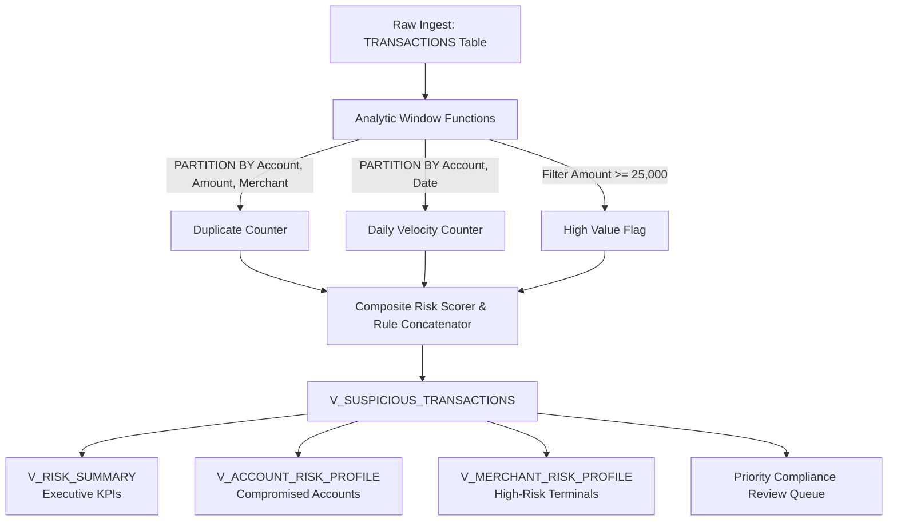

# 🛡️ Transaction Guard

[](https://sindhureny.github.io/transaction_guard/)
[](https://drive.google.com/file/d/1MgY-Qg6QdmKEHT4E20H-TFEcHL1sKirj/view?usp=sharing)
[](https://github.com/Sindhureny/transaction_guard/actions/workflows/ci.yml)
[](https://github.com/Sindhureny/transaction_guard/actions/workflows/pages.yml)
[](https://www.exasol.com/)
[](https://docs.exasol.com/)
[](https://www.python.org/)
[](https://opensource.org/licenses/MIT)

> 🌐 **Live Interactive Web Application**:  
> Experience real-time suspicious transaction scoring, scenario sandbox simulation, and Exasol SQL analytics directly in your browser:  
> 👉 **[https://sindhureny.github.io/transaction_guard/](https://sindhureny.github.io/transaction_guard/)**
> 
> 🎬 **Project Walkthrough & Video Demonstration**:  
> Watch the complete live screen-recording walkthrough and engine demonstration:  
> 👉 **[Watch Video Demonstration (Google Drive)](https://drive.google.com/file/d/1MgY-Qg6QdmKEHT4E20H-TFEcHL1sKirj/view?usp=sharing)**

**Transaction Guard** is an in-memory SQL detection engine built for **Exasol** (and standard ANSI SQL engines) to identify, score, and prioritize suspicious financial transactions.

It utilizes high-performance analytic window functions (`OVER (PARTITION BY ...)`) to detect duplicate billing anomalies, high-dollar risks, and transaction velocity bursts without requiring slow subqueries or row-by-row procedural cursors.

---

## 📌 Detection Rules & Risk Scoring

Transaction Guard monitors incoming ledger data against three core fraud heuristics, calculates individual boolean flags, and assigns a weighted **Risk Score (0 - 100)**:

| Rule ID | Rule Name | Detection Criteria | Weight | Severity Impact |
|---|---|---|:---:|:---:|
| **RULE_01** | **Duplicate Charge Alert** | Multiple transactions sharing identical `ACCOUNT_ID`, `AMOUNT`, and `MERCHANT` | +35 pts | HIGH / CRITICAL |
| **RULE_02** | **High-Value Anomaly** | Single transaction `AMOUNT >= 25,000.00` | +40 pts | HIGH / CRITICAL |
| **RULE_03** | **Daily Velocity Spike** | Account executes `>= 4` transactions within the same calendar day | +25 pts | MEDIUM / HIGH |

### 🎯 Severity Classification
* **CRITICAL (Score ≥ 65)**: Multiple concurrent rule triggers (e.g., high-dollar duplicate or velocity spike). Immediate freeze/escalation.
* **HIGH (Score ≥ 35)**: High-value single transaction or suspected duplicate charge.
* **MEDIUM (Score ≥ 25)**: Rapid card velocity or repeated daily activity.
* **LOW / NORMAL (Score = 0)**: Standard benign transaction cleared for straight-through processing (`NORMAL`).

---

## 🎥 Video Demonstration

A full project screen-recording walkthrough detailing the in-memory SQL heuristics, live dashboard, scenario sandbox simulation, and Exasol architecture:

[](https://drive.google.com/file/d/1MgY-Qg6QdmKEHT4E20H-TFEcHL1sKirj/view?usp=sharing)

> 📹 **Direct Video Link**: [Click here to watch the demonstration on Google Drive](https://drive.google.com/file/d/1MgY-Qg6QdmKEHT4E20H-TFEcHL1sKirj/view?usp=sharing)  
> *Duration: Video demonstration showcasing live transaction flagging, window heuristic inspection, and risk analytics.*

---

## 🏗️ Architecture & Data Flow



---

## 📁 Repository Structure

```
transaction_guard/
├── .github/
│   └── workflows/
│       ├── ci.yml                     # Automated GitHub Actions test pipeline
│       └── pages.yml                  # Automated GitHub Pages deployment pipeline
├── docs/                              # Live Interactive Web Dashboard & Simulator
│   ├── index.html                     # Responsive UI, KPI grid, ledger & explorer
│   ├── styles.css                     # Dark fintech cyber-intelligence design system
│   └── app.js                         # In-memory window heuristics & UI controller
├── sql/
│   ├── 01_schema_and_tables.sql      # Schema & table DDL with constraints
│   ├── 02_detection_views.sql        # Core analytic views & scoring models
│   ├── 03_seed_sample_data.sql       # Idempotent demo dataset
│   ├── 04_analytical_queries.sql     # Production analyst investigation queries
│   └── transaction_guard_exasol.sql  # Combined all-in-one Exasol script
├── src/
│   ├── transaction_guard.py          # Python detection engine (SQLite/Exasol)
│   └── run_demo.py                   # Live CLI interactive demonstration
├── tests/
│   └── test_transaction_guard.py     # Automated unit test suite (100% pass)
├── TransactionGuard.pptx              # Project slide deck (Money, Risk & Regulation)
├── transaction_guard_exasol.sql      # Root convenience copy of master SQL script
├── .gitignore
├── LICENSE                            # MIT License
└── README.md
```

---

## 🚀 Quick Start

### Option A: Running in Exasol (ExaPlus, DBeaver, DBVisualizer)

1. Open your Exasol SQL editor or connect via `exaplus`.
2. Execute the master script [`transaction_guard_exasol.sql`](file:///c:/College%20Notes/Sem%203/Exasol/transaction_guard_exasol.sql):
   ```sql
   -- Run in order:
   -- 1. Creates TRANSACTIONGUARD schema and TRANSACTIONS table
   -- 2. Seeds standard benchmark data (safe to re-run; uses TRUNCATE)
   -- 3. Deploys analytic views
   -- 4. Returns flagged review queue and summary KPIs
   ```
3. Query the investigation queue:
   ```sql
   SELECT * 
   FROM TRANSACTIONGUARD.V_SUSPICIOUS_TRANSACTIONS
   WHERE RISK_STATUS = 'REVIEW'
   ORDER BY RISK_SCORE DESC, AMOUNT DESC;
   ```

### Option B: Running Locally with Python (Zero Setup Required)

You can run and test the complete detection engine locally without needing a live Exasol cluster:

```bash
# Clone the repository
git clone https://github.com/Sindhureny/transaction_guard.git
cd transaction_guard

# Run the interactive CLI report
python src/run_demo.py
```

#### Sample Terminal Output:
```text
========================================================================================
   [+] TRANSACTION GUARD - SUSPICIOUS TRANSACTION DETECTION ENGINE [+]
========================================================================================
   Platform: Exasol In-Memory Analytic Database & ANSI SQL Analytics
   Rules:
     [1] Duplicate Transaction Detection (Account + Amount + Merchant Match)
     [2] High-Value Spike Alert (Amount >= $25,000.00)
     [3] High Daily Velocity (>= 4 Transactions on Same Date)
========================================================================================

TXN ID   | ACC ID   | AMOUNT ($)   | MERCHANT       | SCORE | SEVERITY | STATUS  | RISK REASONS
-----------------------------------------------------------------------------------------------
TXN002   | ACC102   |    27,000.00 | Electronics    |    40 | [HIGH]   | REVIEW  | High transaction amount
TXN003   | ACC103   |       450.00 | Cafe           |    35 | [HIGH]   | REVIEW  | Possible duplicate transaction
TXN004   | ACC103   |       450.00 | Cafe           |    35 | [HIGH]   | REVIEW  | Possible duplicate transaction
TXN005   | ACC104   |       900.00 | Pharmacy       |    25 | [MED]    | REVIEW  | Many transactions in one day
TXN008   | ACC104   |       800.00 | OnlineShop     |    25 | [MED]    | REVIEW  | Many transactions in one day
TXN006   | ACC104   |       700.00 | Grocery        |    25 | [MED]    | REVIEW  | Many transactions in one day
TXN007   | ACC104   |       650.00 | Fuel           |    25 | [MED]    | REVIEW  | Many transactions in one day
TXN009   | ACC105   |     1,500.00 | Clothing       |     0 | [OK]     | NORMAL  | No rule triggered
TXN001   | ACC101   |     1,200.00 | BookStore      |     0 | [OK]     | NORMAL  | No rule triggered
-----------------------------------------------------------------------------------------------

----------------------------------------------------------------------------------------
 [i] EXECUTIVE RISK & COMPLIANCE SUMMARY
----------------------------------------------------------------------------------------
 Total Transactions Processed : 9
 Total Financial Volume       : $33,650.00
 Transactions Under Review    : 7 (77.8%)
 Financial Volume at Risk     : $30,950.00 (92.0%)
 Normal / Cleared Volume      : $2,700.00 (8.0%)
 Severity Breakdown           :
    - CRITICAL: 0 transaction(s)
    - HIGH    : 3 transaction(s)
    - MEDIUM  : 4 transaction(s)
    - LOW     : 0 transaction(s)
    - NORMAL  : 2 transaction(s)
----------------------------------------------------------------------------------------
```

---

## 🧪 Automated Testing

A full regression suite is included in `tests/test_transaction_guard.py` covering:
- ✅ **Baseline test dataset verification**
- ✅ **Exact boundary testing** (e.g. $24,999.99 vs $25,000.00 vs $25,000.01)
- ✅ **Cross-merchant & cross-account false positive prevention**
- ✅ **Multi-rule combination scoring** (ensures secondary reasons aren't masked)
- ✅ **Daily velocity threshold boundary** (3 vs 4 transactions/day)

Run tests locally:
```bash
python -m unittest discover -s tests -p "test_*.py" -v
```

---

## 💡 Improvements Implemented Over Baseline

1. **Elimination of Rule-Masking Bugs**: The original single `CASE WHEN` stopped evaluating after the first match, silently dropping secondary risk factors. The updated engine records distinct boolean flags, concatenates all triggered rules, and calculates a holistic Risk Score.
2. **Idempotent Benchmark Data**: Added `TRUNCATE TABLE` before inserts so re-executing demo scripts does not corrupt existing partitions with synthetic duplicates.
3. **Enterprise Analytic Views**: Packaged ad-hoc CTE queries into reusable views (`V_SUSPICIOUS_TRANSACTIONS`, `V_RISK_SUMMARY`, `V_ACCOUNT_RISK_PROFILE`, `V_MERCHANT_RISK_PROFILE`).
4. **Automated CI/CD**: Added a GitHub Actions workflow testing Python 3.10 through 3.13 on every commit.
5. **Interactive Web Dashboard & Scenario Simulator**: Designed and deployed a real-time compliance investigation dashboard with interactive scenario simulations, window heuristic breakdown, and SQL explorer hosted live on GitHub Pages.

---

## 📄 License

This project is licensed under the [MIT License](LICENSE).
